<p align="center">
  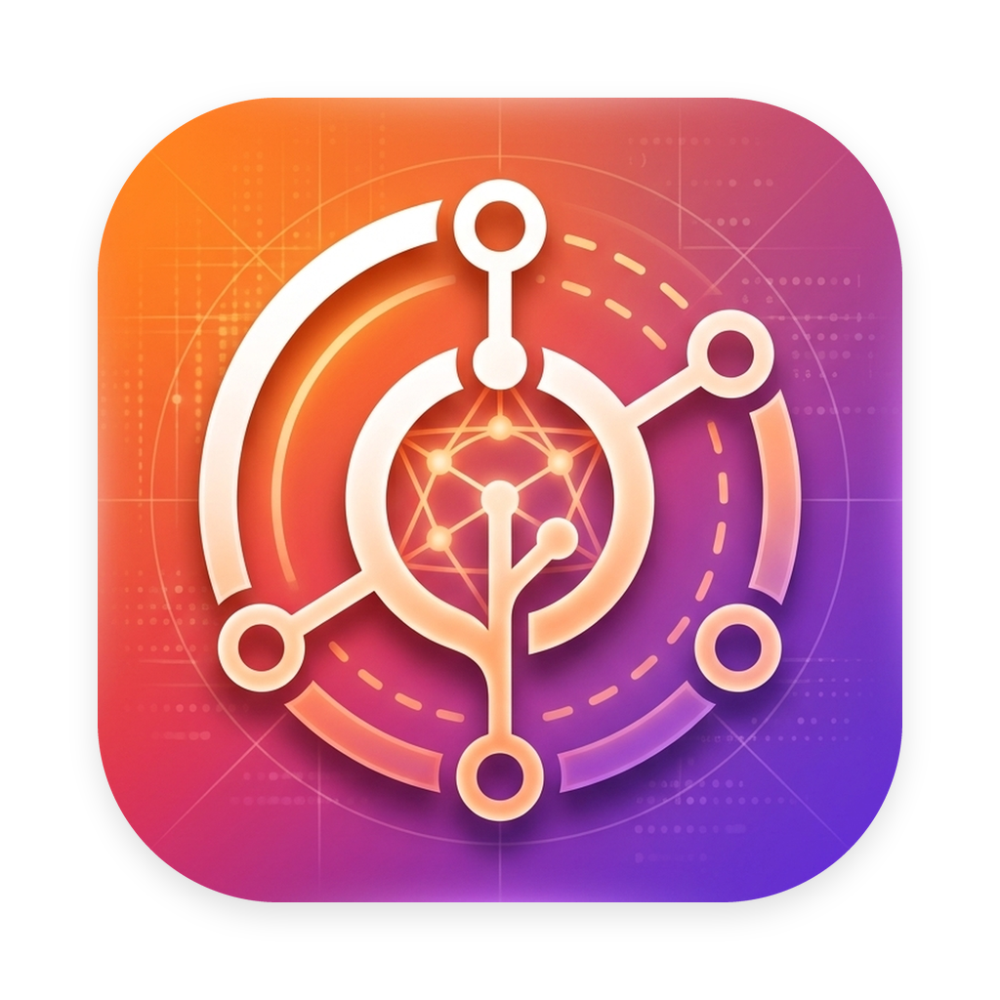
</p>

<h1 align="center">OmniRepo</h1>

<p align="center"><b>Understand any codebase, model, or dataset in minutes — on your Mac and iPhone.</b></p>

<p align="center">
  <a href="https://github.com/chengjianglong/OmniRepo/releases/latest"><b>⬇ Download for macOS</b></a> ·
  <a href="media/omnirepo-demo.mp4">▶ Watch the demo (28 s)</a> ·
  <a href="#install">Install</a> ·
  <a href="#features">Features</a>
</p>

<p align="center">
  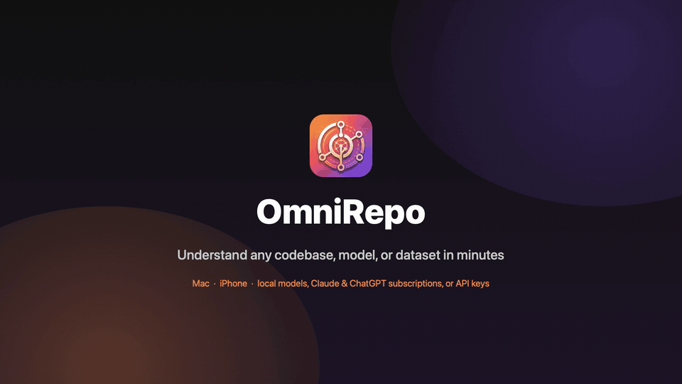
</p>

A native macOS 14+ SwiftUI app for analyzing local Git checkouts, remote Git repositories (GitHub, GitLab, Bitbucket, any https Git host), and Hugging Face models, datasets, and Spaces. It runs local models through Ollama (Recursive's Flint 40B by default, or any model you pull, such as Qwen or LFM), and can optionally use Claude and GPT through your subscription or an API key, including side-by-side comparisons. The Mac app has no third-party Swift dependencies; the iPhone app adds MLX Swift for its optional on-device model.

## Screenshots

| | |
|---|---|
| 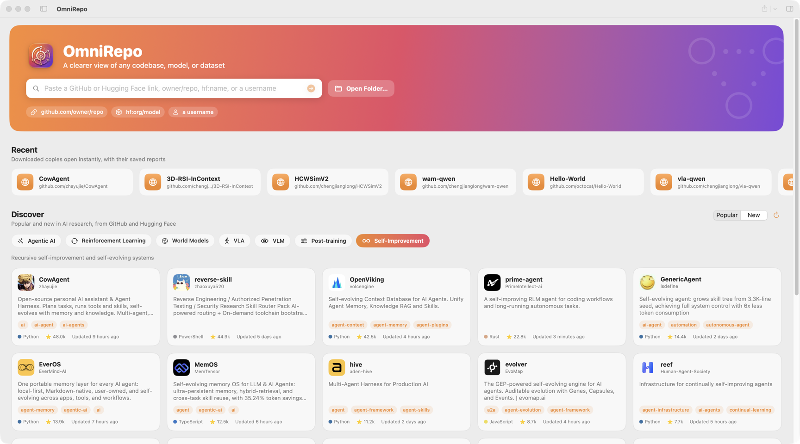<br>**Discover** — paste a GitHub or Hugging Face link, or browse popular and new AI repositories by topic. | 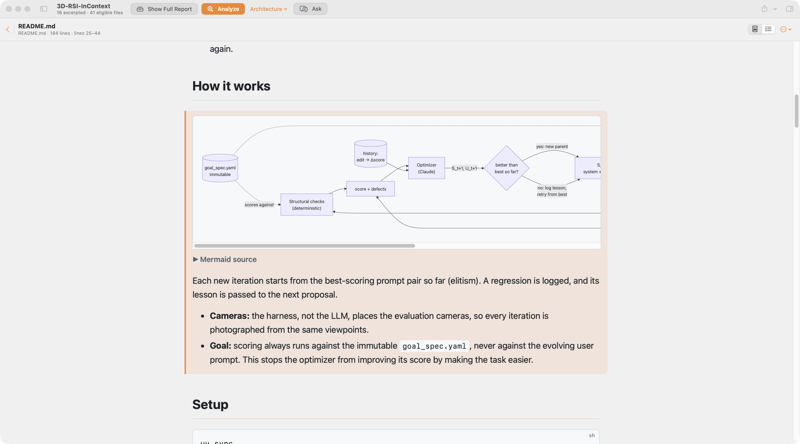<br>**Read** — READMEs render like GitHub, Mermaid diagrams included; cited lines are highlighted. |
| 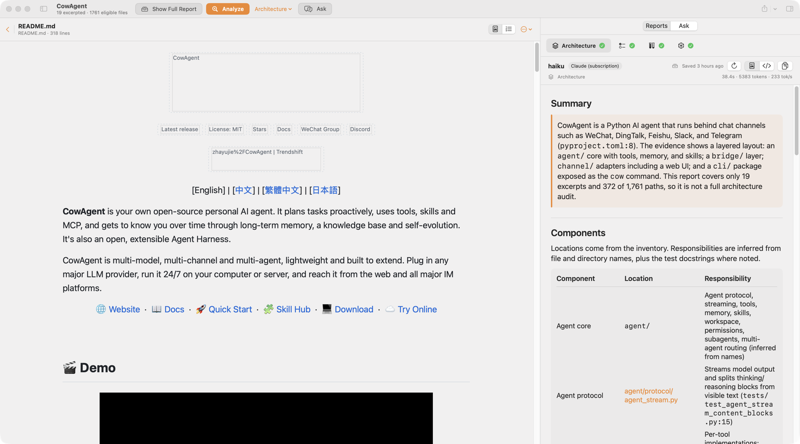<br>**Analyze** — architecture, code review, test gaps, and model card reports, saved so they aren't paid for twice. | 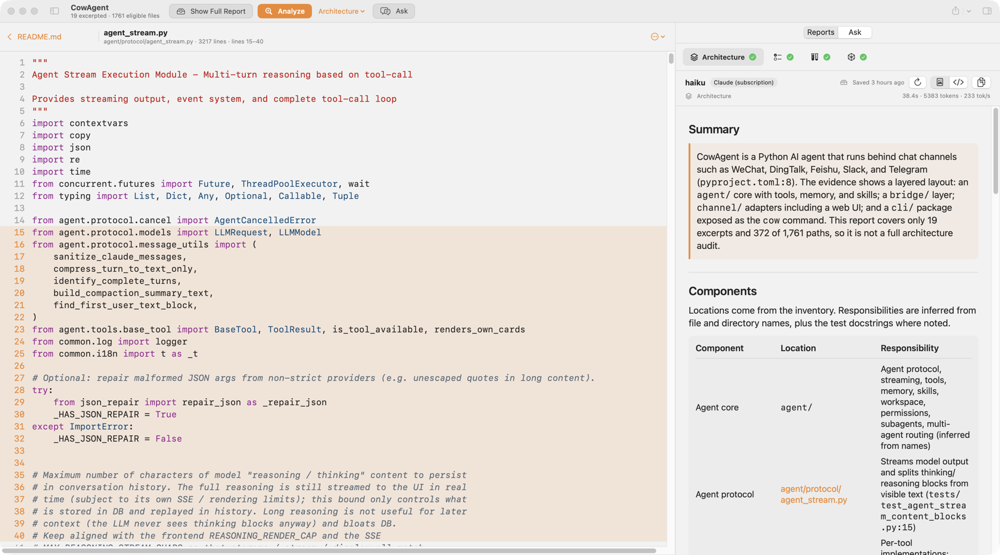<br>**Verify** — every `path:line` citation opens the code with those lines highlighted. |
| 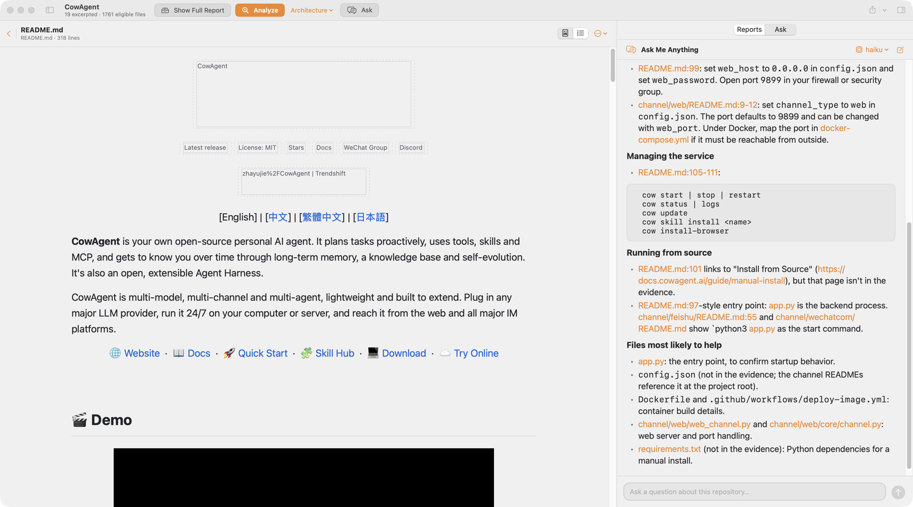<br>**Ask** — ask anything about the repository; answers cite files, and follow-ups remember the conversation. | 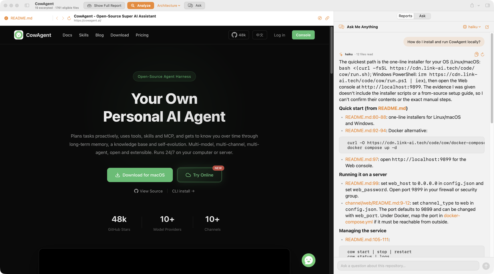<br>**Browse** — docs and videos from links open right in the repository view; Back returns to the README. |

<p align="center">
  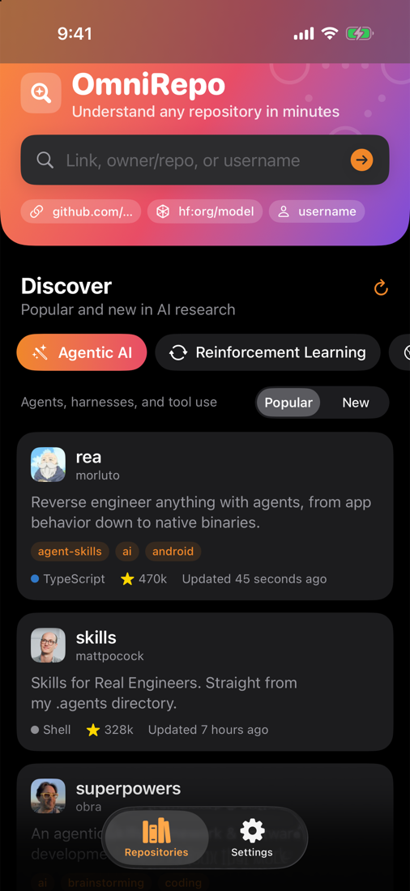
  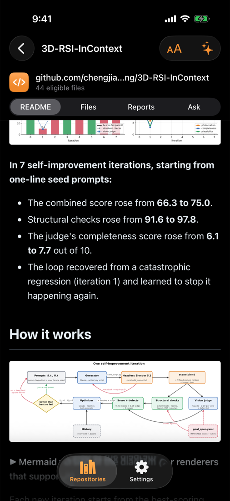
  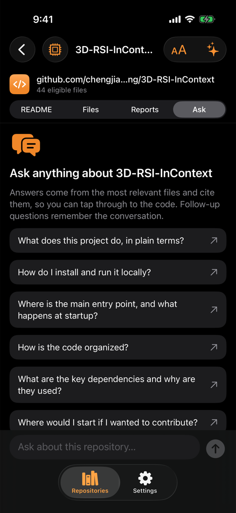
</p>
<p align="center"><i>On iPhone: Discover, GitHub-style READMEs, reports, and Ask — running on your paired Mac, with API keys, or with Qwen on the phone.</i></p>

## Install

1. Download **OmniRepo-x.y.z.dmg** from [Releases](https://github.com/chengjianglong/OmniRepo/releases/latest). It runs on macOS 14 or later, on Apple silicon and Intel Macs.
2. Open the DMG and drag **OmniRepo** to **Applications**.
3. The app isn't notarized by Apple yet, so the first time you open it macOS blocks it. Either right-click (Control-click) **OmniRepo** in Applications and choose **Open**, then **Open** again; or try to open it once, then go to **System Settings › Privacy & Security** and click **Open Anyway**. If macOS says the app "is damaged", run `xattr -dr com.apple.quarantine /Applications/OmniRepo.app` in Terminal and open it again.
4. Pick a model: install [Ollama](https://ollama.com) for local models, sign in to the `claude` or `codex` command-line tools to use your Claude or ChatGPT subscription, or add an Anthropic or OpenAI API key in **Settings › Cloud Models**. Then paste a repository link and press **Full Report** or **Ask**.

## Build and run from source

> The Swift source isn't published in this repository yet; these steps apply to the full source tree. To just use the app, see [Install](#install).

1. Install [Ollama](https://ollama.com) and start the Ollama application (or run `ollama serve`).
2. Download the model: `ollama pull flint:40b`.
3. Build with `./scripts/build-app.sh` (requires Xcode command-line tools and Swift 6).
4. Open `dist/OmniRepo.app`.
5. Open a local checkout (⌘O, or `open -a OmniRepo --args --open /path/to/checkout`) **or** paste a URL (`github.com/owner/repo`, `https://huggingface.co/owner/model`, `hf:datasets/owner/name`, `hf:spaces/owner/app`) in the sidebar. Press **Full Report** (⇧⌘↩) for all four reports, or **Analyze** (⌘↩) for the report chosen in the menu beside it. The question and models are set in Settings › Ask (⌘,).

The [official Ollama model](https://ollama.com/library/flint) is approximately 23 GB to download. Allow additional memory for runtime and context; sufficient free storage alone does not guarantee the model fits in memory. This app requests a 48K context and uses the model's own sampling settings. Flint is a reasoning model that can reason indefinitely before answering, so OmniRepo caps its reasoning at 6,144 tokens: if it has not finished by then, the app closes the reasoning block and the model writes its answer (up to 8,192 tokens) from what it has worked out. An analysis typically takes 2–3 minutes. Other models use Ollama's chat API with low reasoning effort when they support thinking. Model installation and server startup are separate from the app.

## Features

- **Ask Me Anything (⌘K):** a conversation about the open repository in the report panel's Ask tab (a fourth tab on iPhone). Each question selects the most relevant files; answers cite `path:line`, and follow-up questions include the recent conversation. Pick the answering model in the tab; conversations are saved per repository.
- **Mermaid diagrams:** ```` ```mermaid ```` blocks in Markdown files are drawn as diagrams (Mermaid 11.4.1, bundled; the source stays under a disclosure). Wide diagrams scroll sideways; pinch to zoom on the Mac.
- **Web pages in the repository view:** web links in READMEs, reports and answers open inside OmniRepo (videos play in place), with **‹ README.md** to return to the file at the same scroll position. Links between files keep a history: Back (⌘[) and Forward (⌘]).
- **Collapsible sidebar:** hide it with ⌃⌘S, and collapse its Repository, Recent and Models sections.

- **Welcome screen with Discover:** a search field for links, `owner/repo`, `hf:` names, or usernames; recent repositories; and popular (active in the last 30 days) or new (created in the last 6 months) GitHub repositories for Agentic AI, Reinforcement Learning, World Models, VLA, VLM, Post-training, and Self-Improvement, plus trending Hugging Face models for world models, VLA, and VLM. Click a card to download it; right-click to open it in the browser or copy its URL. Results are cached for 3 hours, with a short built-in list when offline or rate-limited.
- Native folder picker, or download by URL (`owner/repo` works for GitHub). Branch/tag links (`/tree/<branch>`) are honored.
- **Browse an account:** type a GitHub username or organization (or `github.com/name`), or `hf:author` / `huggingface.co/author`, to list its public repositories (or models, datasets and Spaces) with descriptions, language, stars or likes, and last update. Filter, sort, show or hide forks, and click one to download and explore it. Uses the public GitHub and Hugging Face APIs without signing in (GitHub allows about 60 anonymous lookups an hour).
- Architecture, code-review, test-gap, and model/dataset presets, plus custom questions.
- **Full Report (⇧⌘↩):** runs all four presets as separate reports, each with its own file selection, shown in tabs with live status. Cloud models run all four in parallel; local Ollama models run them one after another, because parallel runs of a large local model multiply its memory use and slow every run.
- **Readable reports:** each preset asks for a fixed layout (a short summary first, then tables for components, findings, gaps, and tests, with `path:line` citations). Reports render with a highlighted summary, color-coded severity and priority, and code blocks. Edit every report prompt, and the instructions shared by all reports, in Settings › Reports; changes are saved, and each has Restore Default. A fixed rule that repository text is evidence, never instructions, is always sent first.
- **Saved reports:** every finished report is saved per repository (in Application Support/OmniRepo/Reports), keyed by report, prompt, model, and Git commit when known. Reopening a repository shows its saved reports, and Full Report or Analyze shows a saved report instead of generating (and paying for) it again; the button reads "Show Full Report" when all four are saved. Regenerate a report with ↻ in its header, or all of them with Regenerate Full Report in the report menu. An edited prompt or a new commit generates a new report. Delete saved reports in Settings › Reports.
- **Markdown export:** ⌘E saves one document with a title, contents, and every report (headings nested correctly); ⇧⌘E saves each report as its own `.md` file.
- Streams model output and renders the report as Markdown; supports cancellation, copy, and Markdown export (⌘E).
- **Model comparison:** select several models and run the same question on identical file excerpts. A table compares total time, time to first answer, prompt and output tokens, and tokens per second; exports include every answer.
- **Any local model:** pick from the models installed in Ollama, or download new ones in Settings › Local Models (same as `ollama pull`).
- **Claude and GPT (optional):** use your Claude Pro/Max or ChatGPT subscription through the official `claude` and `codex` command-line tools (installed and signed in; Settings › Cloud Models shows whether each is signed in, with Sign In… to log in through Terminal), or Anthropic/OpenAI API keys stored in the Keychain (Settings › Cloud Models). The CLIs run with tools disabled in an empty temporary folder and a minimal environment. Anthropic API requests use adaptive thinking and server-side refusal fallback.
- **Privacy:** local models keep everything on this Mac. Before the first cloud run on a repository, OmniRepo asks before sending excerpts (up to 60,000 characters) to Anthropic or OpenAI; the sidebar shows when any selected model runs in the cloud. Settings can clear these permissions.
- **Repository side panel (⌥⌘0):** browse and filter the tracked files, read code with syntax highlighting (Python, Swift, JavaScript/TypeScript, Go, Rust, C/C++, Java/Kotlin, Ruby, shell, JSON, YAML, TOML, HTML/XML, CSS, SQL, Lua, R, Dockerfile) and line numbers, preview images, and view Markdown rendered as on GitHub (tables, images including raw `` HTML, alerts, task lists, highlighted code blocks) or as source. The Markdown page runs with JavaScript disabled and a policy that blocks all network loads: repository images are embedded, remote images such as badges show their alt text, repository links open in the panel, and web links open in the repository view. Every `path:line` citation in a report is a link that opens the file with those lines highlighted (only real tracked files are linked). Reveal in Finder and copy path, citation, or contents from the panel. `--file path:line` opens a file at launch.
- Reports excerpt coverage. Recent repositories are listed in the sidebar.
- **Display:** change the text size (View › Bigger ⌘+ / Smaller ⌘− / Actual Size ⌘0, 80–200%), the reading font (San Francisco, New York serif, Rounded, Monospaced), and the appearance (Automatic, Light, Dark) in the View menu or Settings › Display. They apply to READMEs, code, and reports.
- Reads tracked working-tree files without changing the checkout or executing its code.

## Use from Claude Desktop (MCP)

The app bundle includes `omnirepo-mcp`, a stdio MCP server, so Claude Desktop chats can work with any Git or Hugging Face repository. Register it in `~/Library/Application Support/Claude/claude_desktop_config.json`, then fully quit and reopen Claude:

```json
{
  "mcpServers": {
    "repolens": {
      "command": "/path/to/OmniRepo.app/Contents/MacOS/omnirepo-mcp"
    }
  }
}
```

Tools (all read-only):

| Tool | What it does |
|------|--------------|
| `open_repository` | Downloads (or reuses the cached copy) of a GitHub/GitLab/Bitbucket/Git URL, a Hugging Face URL, `hf:owner/name`, or an absolute local path, and summarizes its files and skipped LFS files. `refresh: true` re-downloads. |
| `list_files` | Lists eligible tracked files, with an optional substring filter. |
| `read_file` | Returns a tracked text file with line numbers, paged by `start_line`/`end_line`. Only paths from `list_files` are allowed. |
| `analyze_with_flint` | Runs the same local Flint/Ollama analysis as the app and returns the report. Uses the endpoint/model saved in the app; a typed `flint:40b` also matches installed variants such as `flint:40b-a2b-qat-int4`. |

Downloads are shared with the app (same cache folder). The server sends nothing to Claude except the tool results Claude requests; inference in `analyze_with_flint` stays on this Mac. If you move the app, update the `command` path.

## iPhone and iPad

`iOS/` contains OmniRepo for iPhone and iPad. It shares `RepoCore` and the Mac app's `Workspace`, Markdown, and display code, and adds a touch UI: a home screen with a search field (links, `owner/repo`, `hf:` names, or a username to list an account's repositories), recent repositories, and **Discover** — popular (most-starred, active in the last 30 days) and new (created in the last 6 months) GitHub repositories for Agentic AI, Reinforcement Learning, World Models, VLA, VLM, Post-training, and Self-Improvement, plus trending Hugging Face models for world models, VLA, and VLM (cached for 3 hours; a short built-in list shows when offline or rate-limited); README, Files, and Reports tabs on each repository (starting a report switches to Reports; a `path:line` citation opens the file, and Back returns to the report), an Analyze menu (Full Report or one report, reusing saved reports, with Regenerate), sharing reports as Markdown, and an Aa menu for text size, font, and appearance.

- **No Git on iOS:** repositories download over HTTPS from the GitHub and Hugging Face APIs instead of `git clone`. Text files up to 512 KB and images are downloaded (at most 1,500 files and 60 MB); weights, archives, media, and Git LFS files are listed but not downloaded. Other Git hosts need the Mac app.
- **Your Mac's models, including subscriptions:** turn on Settings › iPhone & iPad in the Mac app, then on the phone open Settings › Your Mac, pick the Mac (found over Bonjour) or type its name, and enter the pairing code. Reports with Ollama and your Claude Pro/Max and ChatGPT subscriptions then run on the Mac (through the `claude` and `codex` tools) and stream back over the local network (port 47630). Requests need the pairing code but are not encrypted; use trusted networks. Keep the Mac app open.
- **Qwen on the iPhone itself:** Settings › On this iPhone downloads Qwen3.5 2B (4-bit MLX, about 1.6 GB, from Hugging Face). It then appears as a model "On this device", and when the paired Mac can't be reached, reports that would have run on the Mac run with it instead (a note says so; turn this off in the same section). It reads up to 24,000 characters of excerpts rather than 60,000 and is slower and less capable than the Mac's models. MLX needs a real device; it does not run in the Simulator.
- **Other models:** Anthropic and OpenAI API keys stored in the device Keychain, or Ollama directly (needs `OLLAMA_HOST=0.0.0.0` on the Mac).

Build and install on a connected device (needs `xcodegen` and a development team set in `iOS/project.yml`):

```sh
cd iOS && xcodegen generate
xcodebuild -project OmniRepo.xcodeproj -scheme OmniRepoMobile -destination 'id=<device UDID>' -derivedDataPath ../.build/ios-app -allowProvisioningUpdates build
xcrun devicectl device install app --device <device UDID> ../.build/ios-app/Build/Products/Debug-iphoneos/OmniRepo.app
```

## Scope and limits

Downloads are shallow (`--depth 1`), single-branch, https-only clones stored in `~/Library/Caches/local.repolens.app/Clones` ("Clear downloads" removes them). Git LFS content is **not** downloaded, so model weights and data shards stay as small pointer files: their names appear in the inventory, but their contents are not analyzed. Clones run with hooks disabled, symlinks checked out as plain files, submodules skipped, and only the https protocol allowed. Private or gated repositories work only if Git credentials for that host are already configured on this Mac. Bare repositories are unsupported. Analysis uses a prioritized selection of tracked files, not a complete audit: README/manifests and paths matching the question rank first. The app includes at most 60,000 source characters, 10,000 per file, and an inventory of up to 2000 paths / 12,000 characters, leaving room in the 48K context for the reasoning and answer. Binary/non-UTF-8 files, files above 512 KB, symlinks, generated directories, common secret filenames, lockfiles, and untracked files are excluded. Submodule contents are not traversed. Common secret exclusions are not a comprehensive secret scanner.

Answers include model-generated file/line references, which should be verified. Repository text is marked as untrusted evidence in the model prompt. The model has no command-execution or write tools. Each request is independent; this version does not maintain a chat history or persistent index. Reports display as selectable Markdown source.

## Development

```sh
CLANG_MODULE_CACHE_PATH="$PWD/.build/clang-cache" \
SWIFTPM_MODULECACHE_OVERRIDE="$PWD/.build/swift-cache" \
swift test --disable-sandbox
```

Package a universal, ad-hoc-signed installer as `dist/OmniRepo-<version>.dmg` with `./scripts/make-dmg.sh <version>`.

Open `Package.swift` in Xcode to develop. `Sources/RepoCore` contains repository loading and the Ollama streaming client; `Sources/OmniRepo` contains the UI; `Sources/OmniRepoMCP` contains the MCP server. The build script creates an ad-hoc signed local app, not a notarized distribution release.

The test suite covers URL parsing (GitHub, GitLab, Bitbucket, Hugging Face), unsafe-URL rejection, LFS pointer handling, repository loading, untracked/secret/symlink exclusions, invalid repositories, and local endpoint validation. Network clone tests run with `FLINT_LIVE=1 swift test --filter LiveCloneTests`. A live Ollama server with Flint installed is required to validate inference end to end.
